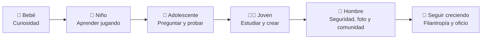

<div align="center">

</div>

# frankjoug

- Hi there 👋 I'm **frankjoug** — filántropo, ingeniero de seguridad, fotógrafo y creador de contenido, con estética cyberpunk 💻✨
- [![Website][website-shield]][website-url] [![GitHub][github-shield]][github-url] [![Spotify][spotify-shield]][spotify-url] [![Threads][threads-shield]][threads-url] [![Instagram][instagram-shield]][instagram-url] [![LinkedIn][linkedin-shield]][linkedin-url]
- 📫 How to reach me: through my [GitHub](https://github.com/frankjoug) — página y proyectos 📩

<table>
<tr>
<td valign="top" width="300">

</td>
<td valign="top">

```console
frankjoug@web:~$ neofetch

OS:      México -> el mundo
Host:    Frankjoug Studio
Kernel:  Seguridad · Fotografía · Contenido
Uptime:  Creando con propósito
Shell:   Cyberpunk / Neón / Modernista
DE:      Cian · Magenta · Morado sobre negro
CPU:     Curiosidad sobrecargada ⚡
GPU:     Visión en neón ✨

status:  [ ACCESS GRANTED ]
```

</td>
</tr>
</table>

- frankjoug's GitHub Stats


> Estas métricas se generan con tu usuario frankjoug. Si al principio se ven bajas, es porque tu cuenta tiene 1 repositorio público y está empezando: crecerán a medida que publiques más proyectos y commits.

## 🧬 Mi evolución



## 🔭 I'm currently working on ...

- **Seguridad** — ingeniería de seguridad y hacking ético: entender sistemas para protegerlos
- **Fotografía** — retrato, calle y paisaje, con ojo editorial
- **Contenido** — creación de contenido, con producción cuidada y estética moderna
- **Filantropía** — proyectos que devuelven algo a la comunidad

## 🌱 I'm currently learning ...

- Seguridad ofensiva y defensiva, cada día más a fondo
- Nuevas herramientas de fotografía y edición
- Diseño y motion para web, con toque cyberpunk

## 👯 I'm looking to collaborate on ...

- Proyectos de seguridad, fotografía y contenido donde el diseño y el código se crucen
- Iniciativas con impacto social, sin perder la estética

## 💬 Ask me about ...

- Ingeniería de seguridad y hacking ético
- Fotografía y dirección visual
- Creación de contenido y producción
- Filantropía y proyectos comunitarios

## ⭐️ Notable Projects and Contributions ...

- [frankjoug/frankjoug](https://github.com/frankjoug/frankjoug) — mi repositorio de perfil: escalador · viajero · lector · geek
- [Mi página](https://github.com/frankjoug/frankjoug/blob/main/index.html) — página personal estilo terminal, como la de frankjunker87-arch, adaptada a frankjoug
- [Solo se vive una vez — Spotify](https://open.spotify.com/playlist/0J2v02jjfQ4VN7BUYd6HKT) — mi playlist para codear de día y soñar de noche

## 🔗 Mis redes sociales

- [Threads — @robertoherdandez](https://www.threads.com/@robertoherdandez)
- [Instagram — @frankyoug94](https://www.instagram.com/frankyoug94/)
- [GitHub — frankjoug](https://github.com/frankjoug)
- [LinkedIn — frankjoug](https://www.linkedin.com/in/frankjoug/)
- [Spotify — Solo se vive una vez](https://open.spotify.com/playlist/0J2v02jjfQ4VN7BUYd6HKT)

## ⚡ Fun fact: Trabajo la seguridad como la fotografía: precisión primero, encuadre siempre.

```console
frankjoug@web:~$ ./presentacion.sh

[+] cargando módulos .......... OK
[>] nombre ......... Frankjoug
[>] rol ............ Filántropo · Ingeniero de seguridad · Fotógrafo · Creador de contenido
[>] base ........... México -> el mundo
[>] stack .......... Seguridad · Fotografía · Contenido
[>] modo ........... CYBERPUNK [ cian · magenta · morado sobre negro ]
[>] páginas ........ github.com/frankjoug
[>] estado ......... ACCESS GRANTED ✅

frankjoug@web:~$ _
```

[website-url]: https://github.com/frankjoug/frankjoug/blob/main/index.html
[website-shield]: https://img.shields.io/badge/-Website-black.svg?style=for-the-badge&logo=googlechrome&colorB=00e5ff
[github-url]: https://github.com/frankjoug
[github-shield]: https://img.shields.io/badge/-GitHub-black.svg?style=for-the-badge&logo=github&colorB=ff2e88
[spotify-url]: https://open.spotify.com/playlist/0J2v02jjfQ4VN7BUYd6HKT
[spotify-shield]: https://img.shields.io/badge/-Spotify-black.svg?style=for-the-badge&logo=spotify&colorB=1db954
[threads-url]: https://www.threads.com/@robertoherdandez
[threads-shield]: https://img.shields.io/badge/-Threads-black.svg?style=for-the-badge&logo=threads&colorB=00e5ff
[instagram-url]: https://www.instagram.com/frankyoug94/
[instagram-shield]: https://img.shields.io/badge/-Instagram-black.svg?style=for-the-badge&logo=instagram&colorB=ff2e88
[linkedin-url]: https://www.linkedin.com/in/frankjoug/
[linkedin-shield]: https://img.shields.io/badge/-LinkedIn-black.svg?style=for-the-badge&logo=linkedin&colorB=0a66c2

---

*Estructura inspirada en el perfil de [tec-girl](https://github.com/tec-girl), adaptada con la foto, los roles y la estética de frankjoug.*
