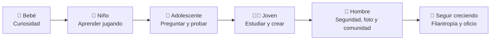

# frankjoug


```text
frankjoug@web:~$ neofetch
OS:      México -> el mundo
Host:    Frankjoug Studio
Kernel:  Seguridad · Fotografía · Contenido
Uptime:  Creando con propósito
Shell:   Cyberpunk / Neón / Modernista
DE:      Cian · Magenta · Morado sobre negro
CPU:     Curiosidad sobrecargada ⚡
GPU:     Visión en neón ✨
status:  [ ACCESS GRANTED ]
```

## 📊 Mis métricas en GitHub


> Estas métricas se generan con tu usuario frankjoug. Si al principio se ven bajas, es porque tu cuenta tiene 1 repositorio público y está empezando: crecerán a medida que publiques más proyectos y commits.

## 🧬 Mi evolución



## 🔭 En qué estoy trabajando

- **Seguridad** — ingeniería de seguridad y hacking ético: entender sistemas para protegerlos
- **Fotografía** — retrato, calle y paisaje, con ojo editorial
- **Contenido** — creación de contenido, con producción cuidada y estética moderna
- **Filantropía** — proyectos que devuelven algo a la comunidad

## 🌱 Estoy aprendiendo

- Seguridad ofensiva y defensiva, cada día más a fondo
- Nuevas herramientas de fotografía y edición
- Diseño y motion para web, con toque cyberpunk

## 👯 Busco colaborar en

- Proyectos de seguridad, fotografía y contenido donde el diseño y el código se crucen
- Iniciativas con impacto social, sin perder la estética

## 💬 Pregúntame sobre

- Ingeniería de seguridad y hacking ético
- Fotografía y dirección visual
- Creación de contenido y producción
- Filantropía y proyectos comunitarios

## ⭐️ Proyectos

- [frankjoug/frankjoug](https://github.com/frankjoug/frankjoug) — mi repositorio de perfil: escalador · viajero · lector · geek
- [Mi página](https://frankjoug.github.io/frankjoug/) — página personal estilo terminal, como la de frankjunker87-arch, adaptada a frankjoug

## ⚡ Dato curioso

Trabajo la seguridad como la fotografía: precisión primero, encuadre siempre.

```text
frankjoug@web:~$ ./presentacion.sh
[+] cargando módulos .......... OK
[>] nombre ......... Frankjoug
[>] rol ............ Filántropo · Ingeniero de seguridad · Fotógrafo · Creador de contenido
[>] base ........... México -> el mundo
[>] stack .......... Seguridad · Fotografía · Contenido
[>] modo ........... CYBERPUNK [ cian · magenta · morado sobre negro ]
[>] estado ......... ACCESS GRANTED ✅
frankjoug@web:~$ _
```

---

*Página inspirada en la estructura de perfil de [tec-girl](https://github.com/tec-girl)*
